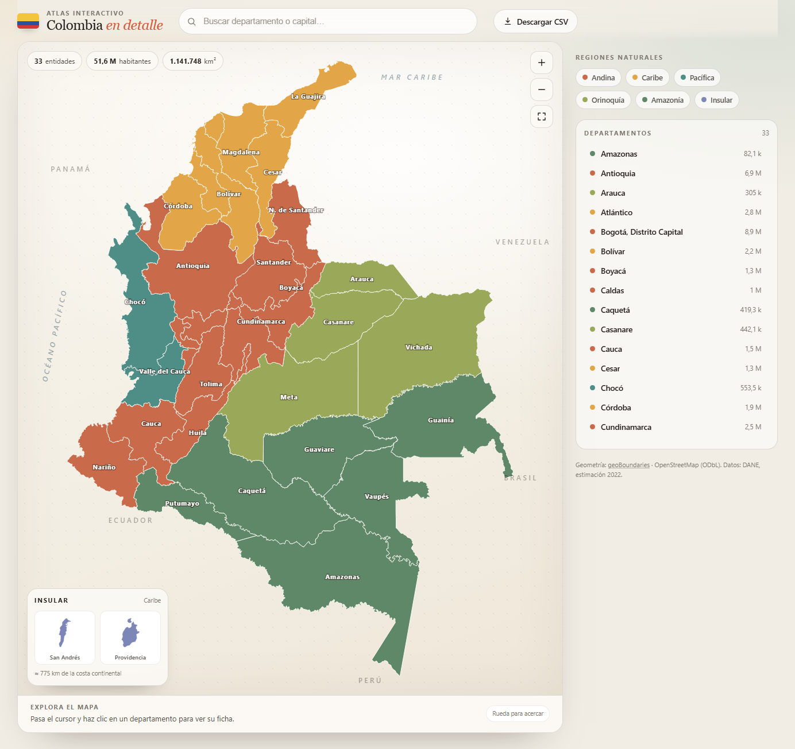

# Atlas de Colombia · Mapa interactivo


Mapa político e interactivo de Colombia con sus **32 departamentos y Bogotá, D. C.**, organizados por las seis regiones naturales del país. Incluye búsqueda, filtros, fichas de información, zoom, arrastre y exportación de datos.

Es un proyecto de consulta y divulgación que funciona directamente en el navegador, **sin frameworks ni dependencias en tiempo de ejecución**. Puedes usarlo, modificarlo y compartirlo libremente.



## Características

- **33 entidades**: 32 departamentos y Bogotá, Distrito Capital.
- **Seis regiones naturales**: Andina, Caribe, Pacífica, Orinoquía, Amazonía e Insular.
- **Mapa interactivo** con globo de información al pasar el cursor y ficha detallada al hacer clic.
- **Zoom y desplazamiento** con rueda, pellizco táctil, arrastre y botones.
- **Búsqueda instantánea** por departamento o capital, con navegación por teclado.
- **Filtros por región** y listado alfabético con población.
- **Datos por entidad**: capital, población, superficie, densidad y participación en la población nacional.
- **Recuadro del archipiélago** de San Andrés, Providencia y Santa Catalina.
- **Exportación CSV** con los datos de las 33 entidades.
- **Diseño adaptable** a escritorio, tableta y móvil.
- **Accesibilidad básica**: navegación con teclado, etiquetas ARIA y foco visible.

## Inicio rápido

### Abrir directamente en el navegador

Descarga o clona el repositorio y abre `index.html`:

```bash
git clone https://github.com/SantiagoCordobaG/Mapa-de-Colombia.git
cd Mapa-de-Colombia
```

También puedes descargar el ZIP desde GitHub y descomprimirlo. La aplicación no necesita instalación, compilación ni conexión a internet para funcionar.

> Si tu navegador aplica restricciones a los archivos locales, usa el servidor local que aparece abajo.

### Servidor local

Para desarrollar o probar la página por HTTP:

```bash
node tools/servidor.js 8099
```

Luego abre <http://localhost:8099>.

## Controles

| Acción | Ratón / teclado | Táctil |
| --- | --- | --- |
| Acercar / alejar | Rueda del ratón, doble clic o botones `+` / `−` | Pellizcar |
| Mover el mapa | Arrastrar | Arrastrar con un dedo |
| Ver una entidad | Pasar el cursor y hacer clic | Tocar |
| Volver a la vista general | Botón de vista general o `Esc` | Botón de vista general |
| Buscar | Escribir en el buscador; `↑` / `↓` y `Enter` | Tocar el buscador |
| Navegar por el mapa | `Tab` para enfocar una entidad y `Enter` / `Espacio` | — |

El botón **Descargar CSV** genera un archivo con los datos de las 33 entidades.

## Datos y fuentes

### Cobertura

El mapa incluye los 32 departamentos y Bogotá, D. C. Cada entidad tiene:

- región natural;
- capital;
- población estimada;
- superficie;
- número de municipios;
- densidad calculada;
- participación en la población nacional.

### Fuentes

- **Población y superficie**: estimaciones de población 2022 del **DANE**, recopiladas a partir de la tabla de departamentos de Colombia.
- **Capitales y municipios**: DANE y Wikipedia.
- **Geometría**: [geoBoundaries](https://www.geoboundaries.org/), conjunto **COL ADM1**, derivado de OpenStreetMap.

> **Aviso:** este proyecto es una herramienta de consulta y divulgación. No es una fuente oficial del Estado colombiano ni sustituye las cifras publicadas por el DANE o las entidades territoriales. Para decisiones técnicas, legales o administrativas, consulta directamente las fuentes oficiales.

### Atribución

La geometría proviene de OpenStreetMap a través de geoBoundaries y está sujeta a la licencia **Open Database License (ODbL)**. Si reutilizas o modificas la base de datos geográfica, conserva la atribución a OpenStreetMap, geoBoundaries y sus colaboradores.

- [Copyright y licencia de OpenStreetMap](https://www.openstreetmap.org/copyright)
- [Texto de la licencia ODbL](https://opendatacommons.org/licenses/odbl/1-0/)
- [Sitio oficial del DANE](https://www.dane.gov.co/)

Los datos demográficos y administrativos deben citarse como **DANE, estimaciones 2022** (recopilación del proyecto).

## Tecnologías

- **HTML5, CSS3 y JavaScript vanilla** para la aplicación.
- **SVG** para el mapa y sus interacciones.
- **D3.js** únicamente durante el proceso de generación de la geometría preproyectada. El navegador no carga D3.

La geometría se sirve como paths SVG ya calculados en `js/mapa-colombia.js`, por lo que el mapa no necesita una librería de mapas en el cliente.

## Estructura del proyecto

```text
.
├── index.html                            # Página principal
├── css/
│   └── estilos.css                       # Estilos y diseño adaptable
├── js/
│   ├── datos.js                          # Datos editables del país y las entidades
│   ├── mapa-colombia.js                  # Geometría SVG preproyectada (generada)
│   └── app.js                            # Interacción, zoom, búsqueda, filtros y ficha
├── data/
│   └── colombia-departamentos.geojson    # Geometría de origen
├── tools/
│   ├── build-mapa.js                     # Regenera la geometría con D3
│   ├── d3.v7.min.js                      # D3 solo para el proceso de generación
│   ├── servidor.js                       # Servidor estático local
│   └── captura.js                        # Utilidad de capturas y pruebas visuales
├── assets/
│   └── vista-general.png                 # Captura usada en este README
├── LICENSE
└── README.md
```

## Personalización

### Cambiar datos

Edita `js/datos.js`. Allí se encuentran:

- los datos generales del país;
- las regiones y sus colores;
- la información de cada departamento o distrito.

Después de cambiar nombres, capitales o cifras, recarga la página. No es necesario regenerar el mapa si solo modificas la información textual.

### Regenerar la geometría

Si actualizas `data/colombia-departamentos.geojson` o cambias la proyección en `tools/build-mapa.js`:

```bash
node tools/build-mapa.js
```

Esto reescribe `js/mapa-colombia.js`. Requiere Node.js 18 o superior. D3 se usa únicamente durante la generación.

### Cambiar colores o tipografía

Los colores de las regiones se definen en `js/datos.js` y las variables visuales en `css/estilos.css`.

## Publicar en GitHub Pages

El proyecto es un sitio estático, así que puede publicarse gratis con GitHub Pages:

1. Entra a **Settings → Pages** en el repositorio.
2. En **Build and deployment**, elige **Deploy from a branch**.
3. Selecciona la rama `main` y la carpeta `/ (root)`.
4. Guarda y espera unos segundos.

La URL prevista es:

<https://santiagocordobag.github.io/Mapa-de-Colombia/>

## Licencia

El **código** de este proyecto se distribuye bajo la licencia **MIT**; consulta [LICENSE](LICENSE).

La **geometría** y los datos de terceros conservan sus propias licencias y condiciones de atribución. La licencia MIT no sustituye la licencia ODbL de la base de datos geográfica ni las condiciones de las fuentes de datos.

Copyright © 2026 SantiDev.

## Contribuciones

Las mejoras, correcciones de datos y propuestas de diseño son bienvenidas. Puedes abrir un *issue* o enviar un *pull request*.

Si detectas un error en una cifra, una capital o un límite departamental, incluye la fuente oficial que respalde el cambio para poder revisarlo.
